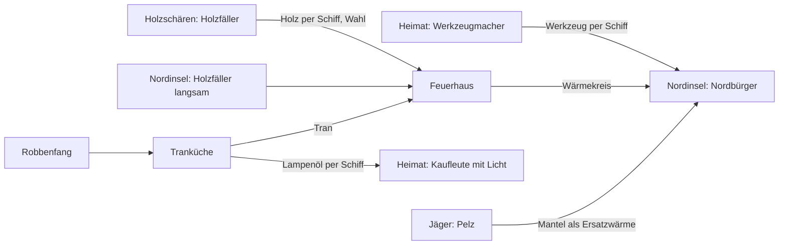

# Erweiterung 2 «Neue Ufer» · Designvorschlag (Etappen NU-1 bis NU-4)

Stand 2026-10-25 · Paket `design-NEUE-UFER` · Prozessstufe voll · Autor `lead-design` · Grundlage: Nutzerentscheid N-104
(R958), Brainstorming mit L0 (R962, F1–F6 wie empfohlen), Auflagen R927 E1/E2 (TIEFE-4) und R933 E1–E5 (Rückfracht),
Skizze [`2026-10-23-tiefe-1-skizzen.md`](2026-10-23-tiefe-1-skizzen.md) §2, Ideen I-194 und I-189 in
[`docs/ideen.md`](../../ideen.md). Stand Code main `b945b279` (Save v18). **Designvorschlag, keine Spec:** Zahlen ohne
Herkunft sind Richtwerte; verbindlich werden sie erst in der Spec der jeweiligen Etappe. Die erste Spec ist
[`2026-10-25-nu1-kartenrand-design.md`](2026-10-25-nu1-kartenrand-design.md). Alle Mechaniken sind Genre-Gemeingut;
Namen und Inhalte sind eigen (ADR-006).

## 1 Spielerzweck und Säule

**In einem Satz:** «Mein Reich ist fertig, aber hinter dem Kartenrand liegt Nebel; ich packe ein Schiff, wähle unterwegs
mit dem, was an Bord ist, decke ein Seegebiet nach dem anderen auf und gründe an einer kalten Küste eine zweite, enge
Stadt um das Feuer, die von Werkzeug aus der Heimat lebt und Lampenöl zurückschickt.»

- **Säule:** Insel besiedeln (Archipel), gestützt von Produktionsketten (Tran, Lampenöl) und Bevölkerung (Nordleute als
  Seitenlinie). Misslingt die Erweiterung, leidet nur die Phase nach Ziel 3; Ziele 1–3 bleiben bitgleich.
- **Neue Frage je Etappe:**
  - NU-1: «Welches Schiff gebe ich her, und was packe ich ein?»
  - NU-2: «Baue ich dicht ums Feuer oder liefere ich Mäntel, und welche Küste nehme ich zuerst?»
  - NU-3: «Wie halte ich den Seeweg in beide Richtungen beladen?»
  - NU-4: «Halte ich beide Reiche zugleich im Gleichgewicht?»
- **Im ersten 15-Minuten-Spiel spürbar?** Nein, und das ist gewollt: Die Erweiterung ist eine Spätphase ab Ziel 3
  (wie Erweiterung 1). Spürbar ist sie in den ersten 15 Minuten **nach** Ziel 3: das Kartenhaus steht nach etwa
  1 Minute, die erste Expedition kehrt nach 3–5 Minuten mit einem Fundstück zurück (Richtwert, NU-1-Spec).

## 2 Rahmen (Rulings R962)

| Nr. | Setzung                                                                                                                                                    | Quelle        |
| --- | ---------------------------------------------------------------------------------------------------------------------------------------------------------- | ------------- |
| F1  | Freischaltung mit Ziel 3 (`wonSpice`), Flotte 4 (`SHIP_MAX`); keine Abhängigkeit von Werft oder Ziel 4 aus Erweiterung 1                                   | R962          |
| F2  | Vier Etappen NU-1 bis NU-4, jede allein releasebar                                                                                                         | R962          |
| F3  | 3 Seegebiete: Nordgebiet (Nordinsel), Holzschären (kleine Waldinseln), Wrackfeld (kein Land); Landnahme-Leiter 1,0 / 1,6                                   | R962, R927 E1 |
| F4  | Expedition ohne Schiffs- und Ladungsverlust; eigener seeded Strom nur für die Wahl-Karten; höchstens eine zugleich; Ende nach dem dritten Gebiet           | R962, T4-1    |
| F5  | 8 Fundstücke als Def-Modifikatoren, nie auf Steuer, Zielschwellen oder Heimat-Bilanz vor Ziel 3; Controller schickt keine Expedition, Baseline bitgleich   | R962          |
| F6  | NU-1 rechnet die Expedition in festen Ticks je Gebiet; Seeweg der Nordinsel und Parzellen der Nordhäuser legt NU-2 erst nach HAFEN- und FLAECHE-Merge fest | R962          |
| W   | Wärme als Kreis (Reichweite über Wege) mit Ware als Ersatz                                                                                                 | R927 E2       |
| R   | Rückfracht E1–E5: Nordhändler führt kein Werkzeug, Lampenöl nicht kaufbar, Lampenöl ist Zusatz, Werkzeug 0,1 als Heimatgut, Warnung bei Nordlager < 2 min  | R933          |

## 3 Kernmechaniken

### 3.1 Nebel und Seegebiete (NU-1)

- Die Seekarte (Popover «Inseln», `src/render/seaMap.ts`) bekommt am Rand des Archipels drei **Nebelfelder**. Jedes
  zeigt Namen erst nach dem Aufdecken, vorher nur zwei **Hinweis-Waren** (z. B. «Eis: Werkzeug, Kälte: Stoff»), damit
  das Packen planbar ist.
- Nebel liegt nur auf der Seekarte, nicht in der Weltansicht (Perf, Art-Umfang klein).
- Ein Gebiet ist aufgedeckt, wenn eine Expedition es bis zum letzten Abschnitt durchfährt. Danach ist es dauerhaft offen.
- Hinter jedem Gebiet steht ein eigener Fund (Recherche B-02: Aufdecken trägt, wenn jede Stelle eine eigene Geschichte
  hat): die vereiste Nordküste, die Schären mit Wald, das Wrackfeld mit den meisten Fundstücken.

### 3.2 Expedition mit Ladeliste (NU-1, I-189, T4-1)

- **Kartenhaus** (Heimat, einmal): schaltet Expeditionen frei. Geldsenke ohne Geldlohn (R722).
- Der Spieler wählt ein Schiff und ein Nebelgebiet, packt bis 50 Einheiten aus dem Heimatlager. Das Schiff verlässt
  seine Route für die Fahrt.
- Unterwegs: 2–3 **Wahl-Karten** aus dem Kartenpool des Gebiets (eigener seeded Strom, keine Karte doppelt je Fahrt).
  Jede Option nennt eine **Bedingung** (Ware an Bord, wird verbraucht). Fehlt sie, ist die Option gesperrt, Grund
  sichtbar. Die riskante Option kostet mehr Ware und bringt das Fundstück; die sichere bringt keins.
- **Proviant** wird je Abschnitt verbraucht. Reicht er nicht, kehrt das Schiff ohne Lohn um; das Gebiet bleibt im Nebel.
- Kein Würfel, kein Moralbalken, kein Verlust (Recherche B-12/B-13: Quoten frustrieren; Ton ruhig).
- Die Spannung liegt in der Kapazität: Proviant gegen Bedingungsware bei 50 Plätzen, und im Schiff, das der Route fehlt.

### 3.3 Fundstück-Sammlung (NU-1)

- 8 Stücke, jedes mit kleiner, in jeder Partie sichtbarer Wirkung (Recherche B-06: ungenutzte Boni werden ignoriert).
- Optional ein kleiner Satzbonus für alle 8; kein Prozentstapel.
- Die Sammlung ist auch Schauwert: eigene Liste in der Seekarte, Chronik-Eintrag je Fund.
- Werte und Katalog: NU-1-Spec, Anhang 01.

### 3.4 Nordinsel, Holzschären und Wärmekreis (NU-2)

- **Erzeugung erst bei der Landung** in einem eigenen Strom, damit Weltgenerierung und Ziele 1–3 bitgleich bleiben.
  Code-Fakt: Häuser, Lager und Kontor auf Fremdinseln gibt es schon (`src/sim/placement.ts`, `src/sim/population.ts` je
  `house.island`). Die Nordinsel ist technisch eine weitere Insel mit Klimaregel, kein neues Stadtmodell.
- **Landnahme-Leiter** (T4-3): erstes neues Kontor ×1,0, zweites ×1,6 vom Grundpreis, in Geld und Baustoff. Zählt der
  Bestand, nicht die Geschichte.
- **Klima kalt:** Holz wächst langsam (weniger Wald, längerer Zyklus), Fischfang reich.
- **Wärmekreis** (T4-2): Ein **Feuerhaus** wärmt Häuser über Wege im Umkreis (wie Markt-Reichweite, Richtwert 8–10).
  Es verbrennt Holz, ab NU-3 wahlweise Tran. Häuser ausserhalb decken Wärme mit **Pelzmänteln** (teurer als Brennstoff).
  Nur Häuser brauchen Wärme; Betriebe nicht (Ton).
- **Holz im Norden ist eine Wahl:** viele langsame Holzfäller auf knapper Fläche, eine Holzroute von den Schären
  (bindet ein Schiff) oder früh auf Tran umstellen (NU-3).
- **Nordleute Stufe 1 «Hüttenleute»:** Fisch, Wärme; Steuer klein. Seitenlinie, keine sechste Stufe.
- Abhängig von HAFEN (Seeweg in Fahrzeit `ceil(L·k)`) und FLAECHE (Parzellen, Flächenbetriebe): Werte erst nach deren
  Merge (F6).

### 3.5 Lebensader (NU-3)

- **Nordleute Stufe 2 «Nordbürger»:** zusätzlich Werkzeug 0,1 je Einwohner und 100 Ticks (R933 E4) und Pelz.
- Der Nordhändler führt kein Werkzeug (R933 E1). Werkzeug kommt aus der Heimat, gekauft oder gebaut.
- **Kette:** Robbenfang → Tranküche → Tran (Brennstoff, ersetzt Holz im Feuerhaus) und → Lampenöl (Export).
- Lampenöl ist nicht beim Händler kaufbar (R933 E2); Verkaufspreis ≤ Kettenkosten (kein Verkaufskreis).
- Warnung bei Nordlager Werkzeug < 2 min (R933 E5); ohne Werkzeug fällt das Nordhaus nach etwa 35 s ab (gerechnet).
- Flotte 4: Nordroute 2 Schiffe + Gewürz 1–2 = voll; echte Wahl gegen Expedition und Holzroute (Rückfracht §4).

### 3.6 Zwei Reiche (NU-4)

- **Licht** als Zusatz der Kaufleute daheim (R933 E3): Lampenöl 0,1, halbiert keine Steuer; sichtbar als warmes Fenster
  in der Nacht (Tageslicht `src/render/daynight.ts`).
- **Ziel «Zwei Reiche»:** 40 Nordbürger und 60 Kaufleute mit Licht, 10 min gehalten (R933 E3, Richtwert).
- Chronik, Ehrenbuch-Eintrag (I-186), Sammlungsabschluss.
- Optional (nicht im Umfang, eigener Entscheid): Seegebiets-Ereignisse (Eisberg, Treibgut) über die Wahl-Karten.

## 4 Wirtschaftskette (Überblick, Werte in den Etappen-Specs)

- **Bilanz je Einwohner** (Pflicht in NU-2/NU-3-Spec, `design-economy-designer`): Steuer der Nordleute minus anteiliger
  Unterhalt von Feuerhaus, Kontor, Robbenfang, Tranküche und Schiffen; Brennstoff je Haus gegen Steuer.
- **Kein endloser Überschuss:** Lampenöl nicht kaufbar, Verkauf ≤ Kettenkosten; Fundstücke ohne Geldwirkung.
- **Kein zwingender Bankrott:** Ausfall des Lampenöls kostet nur den Zusatz (R933 E3); Nordhäuser fallen ab, die Heimat
  bleibt unberührt.

## 5 Etappen und Meilensteine

| Etappe               | Inhalt                                                                 | Grösse (Richtwert)     | Save   | Abhängig von         | Release allein?                    |
| -------------------- | ---------------------------------------------------------------------- | ---------------------- | ------ | -------------------- | ---------------------------------- |
| **NU-1 Kartenrand**  | Kartenhaus, Nebel auf der Seekarte, Expedition, Kartenpool, Fundstücke | SIM 1 · UI 1 · ART 1   | main+1 | Ziel 3 (live)        | ja: Fundstücke, Ausblick Nordküste |
| **NU-2 Nordinsel**   | Landung, Leiter, Erzeugung, Klima, Wärmekreis, Hüttenleute, Schären    | SIM 2 · UI 1 · ART 2   | main+1 | NU-1, HAFEN, FLAECHE | ja: zweite Stadt mit Wärmepuzzle   |
| **NU-3 Lebensader**  | Nordbürger, Robbe/Tran/Lampenöl, Rückfracht, Warnung                   | SIM 1–2 · UI 1 · ART 1 | main+1 | NU-2                 | ja: Seeweg in beide Richtungen     |
| **NU-4 Zwei Reiche** | Licht der Kaufleute, Ziel, Chronik, Ehrenbuch                          | SIM 1 · UI 1 · ART 0–1 | main+1 | NU-3                 | ja: Abschluss                      |

Summe ≈ 12–15 Pakete. Save-Nummern vergibt die Merge-Reihenfolge (R909). Je Etappe eine Spec (Stufe voll), die
Werte rechnet `design-economy-designer` vorab.

## 6 Save-Folgen

- **NU-1:** neues Weltfeld für die Expedition (Schiff, Gebiet, Abschnitt, Restticks, Ladung, gezogene Karten),
  aufgedeckte Gebiete, Fundstücke, Zustand des Expeditions-Stroms; Kartenhaus als Gebäude. Version +1, alter Stand wird
  mit Hinweis abgewiesen (Test).
- **NU-2:** neue Inseln mit Klima-Kennung erst nach der Landung im Zustand; neue Stufen-Defs; Version +1.
- **NU-3:** neue Güter (Tran, Lampenöl, Pelz) ändern die Lager-Records aller Inseln; Version +1.
- **NU-4:** Zielflag «Zwei Reiche» und Haltezähler; Version +1 (ggf. mit NU-3 gebündelt).
- **Baseline:** Ziele 1–3 bitgleich, weil alles hinter `wonSpice` liegt, kein neues Gut in `orderPool` kommt und der
  Controller keine Expedition schickt. Ab NU-2 neuer Controller-Lauf «Zwei Reiche» erst mit NU-4 (Entscheid dort).

## 7 Abgrenzung

| Nachbar                              | Berührung                                           | Regel                                                                                                                                                                          |
| ------------------------------------ | --------------------------------------------------- | ------------------------------------------------------------------------------------------------------------------------------------------------------------------------------ |
| **Erweiterung 1** «Stände und Segel» | beide hinter Ziel 3; Werft hebt Flotte 4 → 6        | NU hängt nicht an E1 (F1). Kommt E1 zuerst, regelt die spätere Spec nur Koexistenz (getrennte Ziele); kein Inhalt doppelt (E1 §10 schliesst Erkundung, Nebel, neue Inseln aus) |
| **HAFEN** (M14)                      | Fahrzeit `ceil(L·k)`, Anker folgt Kontor, Liegezeit | NU-1 unabhängig (feste Ticks). NU-2 rechnet Seeweg Nordinsel 45–80 (R933 E4) nach HAFEN neu                                                                                    |
| **FLAECHE** (M14)                    | Parzellen für Bürger/Kaufleute, Flächenbetriebe     | NU-2 legt Parzellen der Nordhäuser und Flächen der Nordbetriebe erst nach FLAECHE fest; Wärmekreis gegen Luftregel rechnen                                                     |
| **AUSBAU-LOGIK**                     | Ausbaustufen der Betriebe                           | neue Betriebe der Erweiterung im ersten Schnitt ohne Ausbaustufen                                                                                                              |
| **I-195** «Ernte und Frost»          | Kälte, Brennholz                                    | kein Jahreszyklus; Kälte der Nordinsel ist Dauerklima, kein Wechsel. Kandidat Erweiterung 3                                                                                    |
| **I-196** «Gelehrte und Gilden»      | Dauerwirkungen                                      | Fundstücke sind gefunden und endlich, kein Wissens-Konto, kein Erfindungsbaum                                                                                                  |
| **Rivalen** (TIEFE-5)                | Inseln besitzen                                     | keine Gegenspieler, kein Inselbesitz durch Dritte                                                                                                                              |
| **I-038 / I-036** (geparkt)          | Erkundungsfahrt, Wrack                              | in NU-1 aufgegangen (Wrackfeld); Archiv-Status beim nächsten Pool-Pflege-Schritt                                                                                               |

## 8 Nicht im Umfang (ganze Erweiterung)

- Schiffsverlust, Erfolgsquoten, Moralbalken; mehr als eine Expedition zugleich; Expeditionen nach dem dritten Gebiet.
- Nebel in der Weltansicht; prozedural endlose Gebiete; mehr als 3 Seegebiete und 2 neue besiedelbare Küsten.
- Eine sechste Stufe über den Reedern oder Kaufleuten; Nordleute steigen nicht in Heimat-Stufen auf.
- Betriebe, die ohne Wärme stillstehen; Jahreszeiten; Wissen als dritte Grösse.
- Fernmarkt mit Gedächtnis (T4-6, geparkt), Siedlerfracht (T4-5, geparkt), Zukauf-Faktor an der Nordküste (R933).
- Änderungen an Zielen 1–3, an bestehenden Preisen, an `balance.test.ts`-Pins.

## 9 Art-Bedarf (Notiz für `lead-art`)

- NU-1: Kartenhaus-Sprite (Heimat), Nebelfelder und Gebiets-Silhouetten auf der Seekarte, Symbol je Fundstück (8, klein,
  prozedural oder Glyphe), Expeditionsschiff-Marke auf der Seekarte.
- NU-2: kalte Tönung für Gelände und Wasser der Nordinsel (ADR-012), Feuerhaus, Nordhaus Stufe 1, Holzschären-Bäume,
  Wärmekreis-Overlay.
- NU-3: Nordhaus Stufe 2, Robbenfang, Tranküche; NU-4: Lichtschein der Kaufmannshäuser in der Nacht.
- Insgesamt ≈ 7–9 neue Sprites (Richtwert); keine fremden Assets geplant.

## 10 Risiken

- **Klickarbeit:** Expedition als Pflichtschleife. Gegenmittel: höchstens eine, Ende nach Gebiet 3, Karte wartet ohne
  Zeitdruck.
- **Scheinwahl beim Packen:** «alles einpacken» oder «immer sicher». Gegenmittel: Kapazität 50, Verbrauch statt Pfand,
  Fundstück nur auf dem riskanten Weg (NU-1-Spec, Anhang 01).
- **Gewürzstadt kippt** bei Flotte 4, weil das Expeditionsschiff fehlt: Warnung vor dem Auslaufen (NU-1-Spec).
- **Perf** ab NU-2: zweite Stadt, zusätzliche Inselraster; Messung im NU-2-Plan.
- **Doppelte Senke:** Landnahme-Leiter und Stadtrecht leeren dieselbe Kasse; Rechnung in NU-2.
- **Abhängigkeit HAFEN/FLAECHE** verzögert NU-2; NU-1 ist bewusst davon frei.

## 11 Selbstprüfung Gate Brainstorming (lead-design)

1. **Säule:** stärkt Besiedeln; Ketten und Bevölkerung als Seitenlinie. Misslingt sie, leidet nur die Spätphase.
2. **Echte Wahl:** Schiff hergeben gegen Route; Proviant gegen Bedingungsware; riskant gegen sicher; Küste zuerst
   (Leiter); Feuer gegen Mantel; Holzroute gegen langsamen Wald gegen Tran. Keine Option dominiert nach heutigem Stand;
   je Etappe in der Rechnung zu belegen.
3. **Rückkopplung:** Fundstücke als kleiner, endlicher Motor; Rückfracht als gewollte Kopplung (Störung daheim erreicht
   den Norden verzögert); Leiter als Bremse.
4. **Randfälle:** je Etappe in der Spec (NU-1: Lager leer, Route weg, Speichern unterwegs, Kartenhaus abgerissen, Wahl nie
   getroffen).
5. **Einfachere Variante:** nur Nordinsel ohne Expedition (Insel ist sofort da) wäre billiger, verliert aber die
   Entdeckung, also das Thema; nur Expedition ohne Nordinsel ist NU-1 allein und bleibt als Rückfallstufe releasebar.

**Urteil Selbstprüfung: OK.** Bedenken: Die Werte für Leiter, Wärme und Bilanz je Nordmensch hängen an HAFEN und FLAECHE
(Risiko Verzögerung, nicht Design).

## 12 Offene Entscheide (Entwurf an L0, R471)

| Nr.  | Frage                                                                       | Empfehlung                                                          | Entscheider |
| ---- | --------------------------------------------------------------------------- | ------------------------------------------------------------------- | ----------- |
| NU-a | Namen «Kartenhaus», «Hüttenleute», «Nordbürger», «Holzschären», «Wrackfeld» | ja (Gattungswörter, ADR-006)                                        | L0          |
| NU-b | Nordküste nach NU-1 als «vereist, Landung folgt» sichtbar (Ausblick)        | ja; ohne NU-2 bleibt der Text ehrlich: «noch keine Landung möglich» | L0          |
| NU-c | Controller-Lauf «Zwei Reiche» als neue Baseline                             | erst mit NU-4 entscheiden                                           | L0          |
